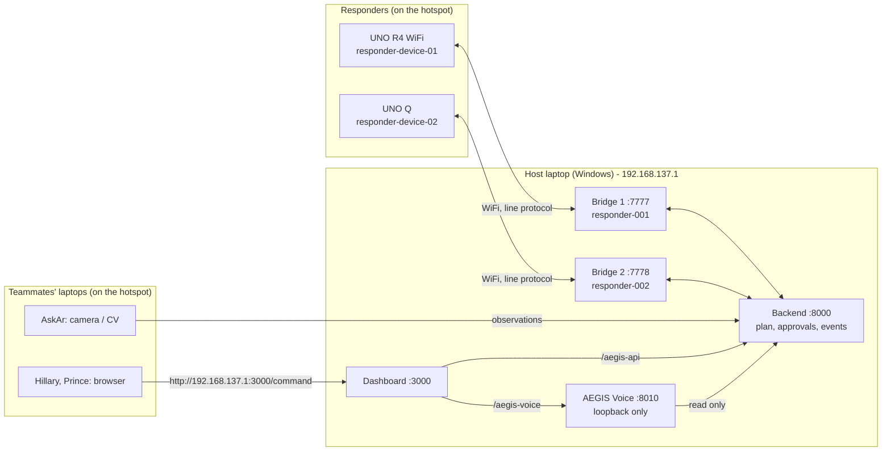

# Demo architecture: one host on the hotspot (SIMULATION ONLY)

For the rehearsal and the live demo, one Windows laptop (Muhammad's) hosts
everything on its own `AEGIS-RESPONDER` hotspot. It is always `192.168.137.1`
there. Teammates' laptops and both Arduinos join that hotspot; nothing listens
on the campus network.



## Hybrid network (what we run)

The hotspot shares one WiFi radio with campus WiFi. It is fine for the two
Arduinos (a few bytes a second) but not for camera video from several laptops:
with laptops on it we measured 200-800 ms delay and 10-30% packet loss, against
about 50 ms and no loss with only the boards. So:

| Device | Network | Uses |
| --- | --- | --- |
| UNO R4, UNO Q | `AEGIS-RESPONDER` hotspot only | `192.168.137.1:7777` / `:7778` |
| teammates' laptops (camera, dashboards) | campus WiFi + Tailscale | the host's Tailscale address, ports 8000 and 3000 |
| host browser | localhost | `http://localhost:3000/command` |

On the host, once per boot, from an Administrator PowerShell
(`hardware/scripts/apply-demo-network.ps1`):

```powershell
.\hardware\scripts\apply-demo-network.ps1
```

It sets the hotspot MTU to 1400 (some laptops never receive full 1500-byte
packets from it, so large replies stalled), adds the firewall rules, and forwards
the host's Tailscale address and `localhost:8000` to the services. It prints the
addresses teammates use. Teammates must be in the host's tailnet, or the host
machine must be shared with them from the Tailscale admin console.

The hotspot-only layout below still works and is the fallback for small traffic.

## The flow

1. The camera posts observations to the backend.
2. The backend proposes assignments. **A human approves and dispatches on the dashboard.**
3. Each bridge sees the assignment for its responder and sends it to its Arduino.
4. The responder presses the button: short press = acknowledged, 1.5 s hold = completed.
5. The bridge posts those device events to the backend; the dashboard updates live.

The devices never approve or dispatch. Every event is `mode: "simulation"`.

## Who runs what

| Person | Machine | Runs | Connects to |
| --- | --- | --- | --- |
| Muhammad | host laptop (Windows) | hotspot, backend, dashboard, Voice, both bridges | - |
| AskAr | own laptop | camera / CV | `http://192.168.137.1:8000` |
| Hillary | own laptop | browser only | `http://192.168.137.1:3000/command` |
| Prince | own laptop | browser; backup host | `http://192.168.137.1:3000/command` |

## Ports

| Port | Service | Bound to | Reachable from |
| --- | --- | --- | --- |
| 8000 | backend | `192.168.137.1` | hotspot devices |
| 3000 | dashboard | `192.168.137.1` and `127.0.0.1` | hotspot devices; host browser |
| 8010 | AEGIS Voice | `127.0.0.1` | host only (others go through the dashboard) |
| 7777 | bridge 1 (UNO R4, `responder-001`) | `192.168.137.1` | hotspot devices |
| 7778 | bridge 2 (UNO Q, `responder-002`) | `192.168.137.1` | hotspot devices |
| 8011 | private proxy | Prince's laptop | fallback path, unchanged |

The backend and the device ports have no authentication, so they are never bound
to `0.0.0.0`. Push-to-talk in the Voice panel needs the browser microphone, which
browsers only allow on `localhost`: use `http://localhost:3000/command` on the
host laptop for voice; other laptops get the text box.

## Start, check, stop

```powershell
.\hardware\scripts\start-demo-host.ps1            # start everything, then health checks
.\hardware\scripts\start-demo-host.ps1 -Status    # health checks only
.\hardware\scripts\start-demo-host.ps1 -Stop
```

Run it once from an Administrator PowerShell so it can add the firewall rule for
ports 8000 and 3000 (hotspot devices only). Logs: `hardware/logs/demo-host/`.

## Not in git (hand over privately)

| File | Needed for |
| --- | --- |
| `voice/.env` (ElevenLabs key) | spoken Voice; without it Voice is text-only |
| `experiments/neural_assignment/weights/` | neural shadow advisory (`-Neural`) |
| `hardware/firmware/aegis_responder/arduino_secrets.h` | flashing the UNO R4 only |

## Fallback

If the host laptop fails, Prince's laptop runs the backend, dashboard and Voice,
and the bridges point at it through the private proxy:
`start-bridge.ps1 -Wifi -Backend <prince-machine> -BackendPort 8011`. The hotspot
and bridges still need a Windows laptop, because the Arduinos cannot join eduroam.
