# Live demo runbook (SIMULATION ONLY)

How the four of us run the AEGIS demo on the hybrid network: both Arduinos on
the host's hotspot, every laptop on campus WiFi + Tailscale. Architecture and
ports: [DEMO_ARCHITECTURE.md](DEMO_ARCHITECTURE.md).



*Illustrative animation of the flow (24 s loop), not a recording of the real system.*

Everything here is a simulation. A human approves and dispatches; the devices
only show a task and report the responder's button presses.

## Roles

| Role | Who | Where |
| --- | --- | --- |
| Host | Muhammad | host laptop: hotspot, backend, dashboard, Voice, both bridges |
| Operator | Hillary (backup: Prince) | dashboard in a browser |
| Cameras | AskAr | own laptop: fixed camera (source of truth) and body cam |
| Responders | two people | carry the UNO R4 (`responder-001`) and UNO Q (`responder-002`) |
| Presenter | Prince | talks to the judges |

## Addresses

| Who | Dashboard | Backend |
| --- | --- | --- |
| Host laptop | `http://localhost:3000/command` | - |
| Teammates on Tailscale | `http://<host-tailscale-ip>:3000/command` | `http://<host-tailscale-ip>:8000` |
| Arduinos (hotspot) | - | bridges on `192.168.137.1:7777` / `:7778` |

`apply-demo-network.ps1` prints the host's Tailscale address. Teammates must be
in the host's tailnet or have the host machine shared with them.

## Before the judges arrive (15 minutes)

Host:

1. Laptop on mains power, sleep disabled, unneeded apps closed.
2. Administrator PowerShell, repo root:
   ```powershell
   .\hardware\scripts\apply-demo-network.ps1
   ```
3. Normal PowerShell, repo root:
   ```powershell
   .\hardware\scripts\start-demo-host.ps1 -Prepare
   ```
   Every line of the health check should say `[ok]`.
4. Power both boards from their power banks. Wait for the corner dot (UNO R4)
   and scrolling `AEGIS` (UNO Q). `--` means not connected yet; give it a minute.
5. Keep the hotspot for the two boards only: no phones, no laptops.

Cameras (AskAr), on campus WiFi with Tailscale on:

```sh
python -m cv.main --config cv/config/demo.yaml --room room-2 --send-signs \
  --stream-port 8090 --backend-url http://<host-tailscale-ip>:8000
```

Operator: open the dashboard, check it says live and shows SIMULATION.

Last check, host: `.\hardware\scripts\start-demo-host.ps1 -Status`.

## The run (about two minutes)

| Step | Who | Does | Everyone sees |
| --- | --- | --- | --- |
| 1 | Cameras | two "casualties" lie in view of the fixed camera | detections on the map and camera tile |
| 2 | Operator | links each detection to a casualty, sets priority | casualty cards fill in |
| 3 | Operator | requests a plan (replan) | a proposal: who goes to whom, with routes |
| 4 | Operator | **approves, then dispatches** | this is the human decision; nothing moves before it |
| 5 | Responders | devices flash the casualty label | `delivered` on the dashboard |
| 6 | Responders | short press | label goes steady; `acknowledged` |
| 7 | Responders | reach the casualty, hold the button 2 s | `OK` on the device; `completed`; responder free again |
| 8 | Presenter | optional: ask AEGIS Voice "what's our current situation?" | spoken or text summary (read-only) |

After a backend start or a Reset there is no proposal until step 3. Do not skip it.

What to say at step 4: "AEGIS recommends, a person decides. The device in the
responder's hand cannot approve or dispatch anything."

What to say at step 7: "The command center now knows what was actually done,
not just what it asked for, and that responder is available for the next task."

## Without the cameras

The demo scene (`-Prepare`) already contains two casualties and two responders,
so steps 3-7 work with no camera running. Use this to rehearse, or if the
cameras fail live: start at step 3.

## If something fails

| Problem | Do this |
| --- | --- |
| A device shows `--` | Keep talking; it reconnects by itself, usually in under a minute. Check it has power. |
| One device is dead | Carry on with the other. Each device only ever shows its own task. |
| Device never lights up after dispatch | Host: `-Status`. Then check the dashboard shows the task as dispatched to that responder. |
| Dashboard stops updating | Check that laptop is on campus WiFi with Tailscale on, then refresh. |
| Dispatch is refused after approve | The plan changed in between (a map or scene change). Request a plan again, approve, dispatch. |
| Camera stalls | Restart the camera command; it re-registers by itself. Or continue from step 3 without it. |
| Host laptop rebooted | Run both scripts from "Before the judges arrive" again. |
| Host laptop is gone | Prince's laptop hosts backend, dashboard and Voice (private proxy on 8011); bridges need a Windows laptop with the hotspot. |
| Nothing works | Play the backup video. |

## Rules during the demo

- One backend: the host's. Nobody else starts one.
- No Reset, restart, pull or re-flash without saying so out loud first.
- Voice push-to-talk works in the host laptop's browser only (`localhost`); other laptops use the text box.
- Not in git, handed over privately: `voice/.env`, the neural weights, `arduino_secrets.h`, the hotspot password.
